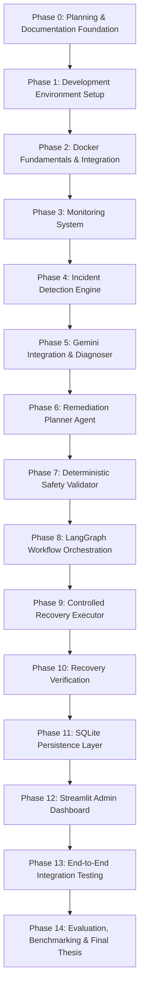

# AUTOHEAL: Comprehensive Implementation Plan

This document establishes the official phase-by-phase implementation roadmap for **AUTOHEAL**.

Every phase defines its objective, necessity, prerequisites, small implementation steps, expected files, expected results, verification procedures, completion criteria, common beginner mistakes, and dependencies on earlier phases.

---

## Implementation Roadmap Overview

---

## Phase 0: Project Planning and Documentation Foundation

- **Objective**: Establish a complete project-management foundation, architectural alignment, documentation standards, granular task tracker, and initial directory skeleton.
- **Why It Is Necessary**: Prevents architectural divergence, scope creep, accidental credential leaks, and unstructured code creation. Ensures a beginner developer has an exact, unambiguous roadmap before writing code.
- **Prerequisites**: Access to the project workspace (`d:\AUTOHEAL`) and verified host software versions.
- **Small Implementation Steps**:
  1. Inspect workspace to confirm clean state.
  2. Create `.gitignore` to prevent secret and database leaks.
  3. Create `.env.example` as a safe configuration template.
  4. Create `docs/PROJECT_STRUCTURE.md` defining directory and module roles.
  5. Create `docs/DECISIONS.md` documenting confirmed choices and rejected alternatives.
  6. Create `docs/ENVIRONMENT.md` with verified host runtimes and unverified target packages.
  7. Create `docs/TESTING_PLAN.md` detailing all 14 test scenarios.
  8. Create `progress.txt` initialized to Phase 0.
  9. Create `PROJECT_CONTEXT.md` as the definitive system architecture reference.
  10. Create `README.md` as the public overview.
  11. Create `IMPLEMENTATION_PLAN.md` (this document).
  12. Create `TASK_TRACKER.md` containing 100+ granular tasks across all 15 phases.
  13. Create initial directory skeleton with placeholder markers.
- **Expected Files / Modules**:
  - Root: `.gitignore`, `.env.example`, `progress.txt`, `PROJECT_CONTEXT.md`, `README.md`, `IMPLEMENTATION_PLAN.md`, `TASK_TRACKER.md`.
  - `docs/`: `PROJECT_STRUCTURE.md`, `DECISIONS.md`, `ENVIRONMENT.md`, `TESTING_PLAN.md`.
  - Directory skeleton: `src/` and subdirectories, `tests/`, `test_environment/`.
- **Expected Result**: Complete documentation ecosystem established with zero application logic implemented.
- **Verification Procedure**:
  - Verify every file exists and contains zero internal contradictions.
  - Verify `.env.example` has no real API keys.
  - Verify verified versions (Python 3.14.2, Docker 29.9.2, Compose v5.6.1, SQLite 3.50.4) are recorded accurately.
- **Completion Criteria**: All 12 files and directory skeleton exist, all documents align, and task tracker contains all 15 phases.
- **Common Beginner Mistakes**:
  - Writing code before planning architecture.
  - Hardcoding API keys into git-tracked files.
  - Claiming features are implemented before writing code.
- **Dependencies on Earlier Phases**: None (Starting phase).

---

## Phase 1: Development Environment Setup

- **Objective**: Set up a clean, isolated Python virtual environment, install target dependencies one by one, verify compatibility with Python 3.14.2, and configure local secrets safely.
- **Why It Is Necessary**: Python 3.14.2 is a very recent release; installing dependencies blindly in a global Python installation can corrupt system packages and cause binary wheel build failures.
- **Prerequisites**: Phase 0 completed; Python 3.14.2 and Docker Engine running on host.
- **Small Implementation Steps**:
  1. Verify host PowerShell execution policy and Python version.
  2. Create an isolated virtual environment (`.venv`).
  3. Activate virtual environment and upgrade pip.
  4. Test installing lightweight utility dependencies (`python-dotenv`, `pydantic`).
  5. Test installing `docker` Python SDK (7.2.0) and verify import.
  6. Test installing `google-genai` (3.6.1) and verify import.
  7. Test installing `langgraph` (1.2.24) and verify import.
  8. Test installing `streamlit` (1.67.0) and `plotly` (6.9.0) and verify imports.
  9. Test installing `pytest` and verify test discovery.
  10. Copy `.env.example` to `.env` and set `DRY_RUN=true`.
  11. Record actual installed versions in `docs/ENVIRONMENT.md`.
- **Expected Files / Modules**:
  - `.venv/` (ignored by Git)
  - `.env` (ignored by Git)
  - Updated `docs/ENVIRONMENT.md` with verified actual versions.
  - `requirements.txt` capturing pinned compatible dependencies.
- **Expected Result**: Working virtual environment with all required packages successfully imported without errors.
- **Verification Procedure**: Run PowerShell one-liners importing every package and printing its version number.
- **Completion Criteria**: All target libraries imported cleanly; `.env` created without leaking into Git.
- **Common Beginner Mistakes**:
  - Installing packages globally without activating `.venv`.
  - Committing `.env` to Git.
  - Installing all dependencies in one command without verifying individual package compatibility.
- **Dependencies on Earlier Phases**: Phase 0.

---

## Phase 2: Docker Fundamentals and Integration

- **Objective**: Establish and verify programmatic communication between Python and the local Docker Engine daemon via the Docker SDK for Python.
- **Why It Is Necessary**: AUTOHEAL cannot monitor or heal containers if the Python runtime cannot interact with Docker.
- **Prerequisites**: Phase 1 completed; Docker Desktop running with named pipe / socket accessible.
- **Small Implementation Steps**:
  1. Create a minimal test container using Docker CLI (`docker run -d --name autoheal-sandbox alpine sleep 3600`).
  2. Write a minimal connection script in `src/utils/docker_client.py` initializing `docker.from_env()`.
  3. Implement functions to ping Docker daemon.
  4. Implement functions to list running containers.
  5. Implement functions to inspect container status, state, and health check config.
  6. Implement functions to stream the last N lines of container logs.
  7. Implement functions to read CPU and memory usage statistics.
  8. Clean up test container.
- **Expected Files / Modules**:
  - `src/utils/docker_client.py`: Docker client connection wrapper with error handling.
  - `tests/unit/test_docker_client.py`: Unit tests for Docker client connection.
- **Expected Result**: Python script successfully connects to Docker, retrieves container metadata, logs, and stats.
- **Verification Procedure**: Run `pytest tests/unit/test_docker_client.py` and print live container stats to terminal.
- **Completion Criteria**: Docker daemon connection passes; container list, logs, and resource stats return valid data.
- **Common Beginner Mistakes**:
  - Docker Desktop is not running when running Python scripts.
  - Confusing Docker named pipe (`npipe://`) on Windows with Unix socket (`unix:///var/run/docker.sock`).
  - Misinterpreting raw Docker memory bytes or CPU delta formulas.
- **Dependencies on Earlier Phases**: Phase 1.

---

## Phase 3: Monitoring System

- **Objective**: Build a deterministic monitoring module that periodically polls monitored Docker containers and collects structured health, state, and resource metrics.
- **Why It Is Necessary**: The self-healing loop requires a continuous stream of telemetry to detect when something goes wrong.
- **Prerequisites**: Phase 2 completed.
- **Small Implementation Steps**:
  1. Define Pydantic models for container metrics (`ContainerSnapshot`, `ResourceMetrics`) in `src/models/telemetry.py`.
  2. Implement container filter by label (`autoheal.monitored=true`) or name list.
  3. Implement deterministic poller in `src/monitor/poller.py`.
  4. Calculate accurate CPU percentage from Docker stats delta.
  5. Calculate memory percentage and absolute usage from Docker stats.
  6. Extract health status (`healthy`, `unhealthy`, `starting`, `none`).
  7. Extract recent log tail (last 50 lines) safely.
  8. Write unit tests for poller using mock Docker responses.
- **Expected Files / Modules**:
  - `src/models/telemetry.py`: Data schemas for container telemetry.
  - `src/monitor/poller.py`: Core deterministic monitoring engine.
  - `tests/unit/test_monitor.py`: Tests verifying telemetry collection.
- **Expected Result**: Monitor collects clean, validated Pydantic snapshots of running containers every polling cycle.
- **Verification Procedure**: Run poller against a test container; assert telemetry output matches expected schema.
- **Completion Criteria**: Poller runs continuously without memory leaks; parses CPU%, RAM, health, and logs reliably.
- **Common Beginner Mistakes**:
  - Using an LLM for routine polling (wasting tokens and introducing latency).
  - Incorrect CPU percentage calculation (forgetting to normalize by system CPU delta and number of cores).
- **Dependencies on Earlier Phases**: Phase 2.

---

## Phase 4: Incident Detection Engine

- **Objective**: Develop deterministic rule-based evaluators that analyze collected telemetry to detect incidents and classify their preliminary severity.
- **Why It Is Necessary**: Detects failures instantaneously without LLM overhead, creating structured incident evidence for root cause analysis.
- **Prerequisites**: Phase 3 completed.
- **Small Implementation Steps**:
  1. Define `Incident` and `IncidentEvidence` schemas in `src/models/incident.py`.
  2. Implement stopped-container detector (exit code != 0, status == `exited`).
  3. Implement unhealthy-container detector (health == `unhealthy`).
  4. Implement high CPU detector (sustained CPU > threshold for N consecutive cycles).
  5. Implement high memory detector (memory > threshold percentage or limit).
  6. Design and prototype single-source traffic flooding detector (log rate or network I/O).
  7. Design and prototype brute-force login detector (repeated `401 Unauthorized` in logs).
  8. Implement severity assignment logic (`Low`, `Medium`, `High`, `Critical`).
  9. Write unit tests covering each detector rule with mock telemetry snapshots.
- **Expected Files / Modules**:
  - `src/models/incident.py`: Incident data model and severity enums.
  - `src/detection/detector.py`: Master detection evaluator.
  - `src/detection/rules.py`: Specific detection rule functions.
  - `tests/unit/test_detection.py`: Unit tests for incident detection.
- **Expected Result**: Whenever an anomaly occurs, an `Incident` object is generated with complete evidence and severity.
- **Verification Procedure**: Feed synthetic failure snapshots into detector; assert correct incident type and severity.
- **Completion Criteria**: 100% of synthetic failure conditions trigger appropriate incident objects; zero crashes on benign data.
- **Common Beginner Mistakes**:
  - Triggering incidents on single transient spikes without sustained window verification.
  - Hardcoding thresholds instead of reading them from configuration.
- **Dependencies on Earlier Phases**: Phase 3.

---

## Phase 5: Gemini Integration and Diagnoser Agent

- **Objective**: Integrate Google Gemini using `google-genai` to analyze incident logs and telemetry evidence, returning structured root-cause diagnoses.
- **Why It Is Necessary**: Raw logs and multi-factor failures are unstructured and complex; an LLM excels at summarizing logs and pinpointing underlying causes.
- **Prerequisites**: Phase 4 completed; valid `GEMINI_API_KEY` configured in `.env`.
- **Small Implementation Steps**:
  1. Initialize `google-genai` client in `src/utils/gemini_client.py`.
  2. Define `DiagnosisResult` Pydantic schema in `src/models/diagnosis.py` (root cause, confidence, evidence summary, suggested severity).
  3. Craft a structured, constrained prompt for root-cause diagnosis.
  4. Implement structured JSON output enforcement using Gemini schema parameters.
  5. Implement API retry logic, timeout handling, and daily quota limits (`MAX_LLM_CALLS_PER_DAY`).
  6. Implement fallback diagnosis logic if the API is unreachable.
  7. Write unit tests with recorded/mock LLM responses to test schema parsing.
- **Expected Files / Modules**:
  - `src/utils/gemini_client.py`: Gemini client setup and rate/quota tracking.
  - `src/models/diagnosis.py`: Diagnosis response schemas.
  - `src/agents/diagnoser/diagnoser.py`: Diagnoser agent logic.
  - `src/agents/diagnoser/prompts.py`: Constrained diagnosis prompt templates.
  - `tests/unit/test_diagnoser.py`: Unit tests for Diagnoser.
- **Expected Result**: Diagnoser receives an `Incident`, queries Gemini, and outputs a validated `DiagnosisResult` object.
- **Verification Procedure**: Run test diagnoses on sample crash logs; verify output strictly adheres to `DiagnosisResult` schema.
- **Completion Criteria**: Diagnoses successfully returned with confidence scores; errors and quota limits handled gracefully.
- **Common Beginner Mistakes**:
  - Allowing free-form unparsed string responses instead of strict Pydantic JSON schemas.
  - Exposing `GEMINI_API_KEY` in code or logs.
  - Not setting request timeouts, leading to frozen executions.
- **Dependencies on Earlier Phases**: Phase 4.

---

## Phase 6: Remediation Planner Agent

- **Objective**: Implement the Planner agent using Gemini to propose remediation action plans selected strictly from a predefined permitted-action allowlist.
- **Why It Is Necessary**: Translates diagnostic root-cause insights into an actionable recovery strategy while strictly preventing arbitrary, dangerous commands.
- **Prerequisites**: Phase 5 completed.
- **Small Implementation Steps**:
  1. Define permitted action enums (`restart_container`, `start_container`, `stop_container`, `reload_service`, `clear_cache`) in `src/models/actions.py`.
  2. Define `RemediationPlan` and `PlanStep` schemas in `src/models/plan.py`.
  3. Craft planning prompt including the diagnosis, container metadata, and strict allowlist constraints.
  4. Implement Planner agent in `src/agents/planner/planner.py` with structured schema generation.
  5. Validate that generated plans only contain known action types and valid target container IDs.
  6. Write unit tests testing valid plan generation and rejection of out-of-bounds proposals.
- **Expected Files / Modules**:
  - `src/models/actions.py`: Allowed action enums and definitions.
  - `src/models/plan.py`: Remediation plan schemas.
  - `src/agents/planner/planner.py`: Planner agent logic.
  - `src/agents/planner/prompts.py`: Planning prompt templates.
  - `tests/unit/test_planner.py`: Unit tests for Planner.
- **Expected Result**: Planner outputs a structured `RemediationPlan` with an ordered sequence of allowable actions.
- **Verification Procedure**: Test with various diagnosis scenarios; assert output actions are exclusively in the allowlist.
- **Completion Criteria**: Generated plans conform 100% to schema; all proposed actions belong to the permitted catalog.
- **Common Beginner Mistakes**:
  - Letting the LLM output arbitrary shell commands (e.g. `rm -rf /` or `apt-get install`).
  - Missing target container parameters or ordering logic.
- **Dependencies on Earlier Phases**: Phase 5.

---

## Phase 7: Deterministic Safety Validator

- **Objective**: Build a deterministic Python safety gate that inspects and validates proposed remediation plans before any execution can take place.
- **Why It Is Necessary**: **Core safety invariant**: An LLM must never have unmediated write access to container runtimes. The Validator guarantees deterministic rejection of unsafe, out-of-scope, or unapproved actions.
- **Prerequisites**: Phase 6 completed.
- **Small Implementation Steps**:
  1. Define `ValidationResult` schema in `src/models/validation.py`.
  2. Implement allowlist validator (reject any action not explicitly in the allowlist).
  3. Implement target scope validator (reject actions targeting unmonitored or system containers).
  4. Implement parameter sanitizer (reject invalid or dangerous parameters).
  5. Implement precondition checker (verify target container exists and is in expected state).
  6. Implement risk assessment rule: flag any action on `Critical` incidents as requiring explicit human approval.
  7. Enforce absolute rule: LLM cannot override a Validator rejection.
  8. Write comprehensive negative tests for allowlist violations, wrong targets, and missing parameters.
- **Expected Files / Modules**:
  - `src/models/validation.py`: Validation result schemas.
  - `src/validator/validator.py`: Core validation engine.
  - `src/validator/policies.py`: Specific safety rules and policy definitions.
  - `tests/unit/test_validator.py`: Negative and positive unit tests for the Validator.
- **Expected Result**: Unsafe plans are completely blocked with explanatory error messages; safe plans are approved.
- **Verification Procedure**: Run test suite asserting that 100% of injected unallowlisted actions are rejected.
- **Completion Criteria**: Zero false negatives on unsafe actions; clear rejection rationales logged; approval flags set accurately.
- **Common Beginner Mistakes**:
  - Allowing the LLM to explain away a safety violation.
  - Trusting container IDs without verifying they belong to the monitored whitelist.
- **Dependencies on Earlier Phases**: Phase 6.

---

## Phase 8: LangGraph Workflow Orchestration

- **Objective**: Assemble Monitor, Diagnoser, Planner, and Validator into a coherent, cyclical state graph using LangGraph.
- **Why It Is Necessary**: Manages the multi-step lifecycle, conditional routing (e.g. re-plan if rejected, pause for approval if critical), and state transitions reliably.
- **Prerequisites**: Phase 7 completed.
- **Small Implementation Steps**:
  1. Define `AutohealState` TypedDict/schema in `src/orchestration/state.py`.
  2. Implement graph nodes for Monitor, Diagnoser, Planner, and Validator in `src/orchestration/nodes.py`.
  3. Define conditional edge routing logic (e.g. `is_plan_valid?`, `requires_human_approval?`).
  4. Implement pause/resume mechanism for human administrator approval.
  5. Implement error recovery and bounded retry limits (prevent infinite loops).
  6. Compile the `StateGraph` and visualize graph structure.
  7. Write integration tests simulating workflow progression across state transitions.
- **Expected Files / Modules**:
  - `src/orchestration/state.py`: Global state definitions.
  - `src/orchestration/nodes.py`: Node handler functions.
  - `src/orchestration/graph.py`: LangGraph workflow assembly and compilation.
  - `tests/integration/test_orchestration.py`: Integration tests for state machine.
- **Expected Result**: Fully functional LangGraph state machine executing the incident lifecycle smoothly.
- **Verification Procedure**: Run integration test executing the graph from incident input to validated plan output.
- **Completion Criteria**: Graph compiles; all nodes transition according to conditional edges; cyclical retries bounded.
- **Common Beginner Mistakes**:
  - Creating circular dependencies that cause infinite loops in the graph.
  - Mutating state outside the LangGraph state update dictionary.
- **Dependencies on Earlier Phases**: Phase 7.

---

## Phase 9: Controlled Recovery Executor

- **Objective**: Implement the Recovery Executor that safely executes approved Docker remediation actions, strictly enforcing `DRY_RUN` mode and execution timeouts.
- **Why It Is Necessary**: Turns validated recovery plans into actual container state changes safely and reliably.
- **Prerequisites**: Phase 8 completed.
- **Small Implementation Steps**:
  1. Define `ExecutionResult` schema in `src/models/execution.py`.
  2. Implement execution controller in `src/executor/executor.py`.
  3. Implement `DRY_RUN` guard: if `DRY_RUN=true`, log action simulation and return simulated success without mutating Docker.
  4. Implement live Docker operations: `restart_container`, `start_container`, `stop_container`.
  5. Enforce strict execution timeouts (e.g., 30s) per action to prevent hanging.
  6. Implement bounded retries for transient Docker daemon errors.
  7. Record detailed execution logs, return codes, and error tracebacks.
  8. Write unit tests verifying dry-run mode never touches Docker.
- **Expected Files / Modules**:
  - `src/models/execution.py`: Execution outcome schemas.
  - `src/executor/executor.py`: Core execution controller.
  - `src/executor/actions/`: Handlers for individual Docker actions.
  - `tests/unit/test_executor.py`: Unit tests for dry-run and live execution.
- **Expected Result**: Actions execute cleanly within timeout bounds, or simulate safely in dry-run mode.
- **Verification Procedure**: Execute in dry-run mode and confirm no container state changes; execute on test container in live mode and verify restart.
- **Completion Criteria**: Dry-run mode 100% verified; live actions execute within timeouts; errors captured cleanly.
- **Common Beginner Mistakes**:
  - Disabling dry-run mode before comprehensive safety testing.
  - Not setting timeouts on Docker API calls.
- **Dependencies on Earlier Phases**: Phase 8.

---

## Phase 10: Recovery Verification

- **Objective**: Implement post-remediation verification to confirm whether the container and application have truly returned to a healthy state.
- **Why It Is Necessary**: Execution success does not guarantee application recovery (e.g., a restarted container might crash again after 2 seconds due to bad config).
- **Prerequisites**: Phase 9 completed.
- **Small Implementation Steps**:
  1. Define `VerificationResult` schema in `src/models/verification.py` (`SUCCESS`, `PARTIAL`, `FAILED`).
  2. Implement cooldown stabilization delay (e.g., wait 5-10 seconds for container startup).
  3. Query post-recovery container status (must be `running`).
  4. Query post-recovery health status (must be `healthy`).
  5. Check post-recovery log tail for immediate panic/crash messages.
  6. Implement escalation routing if verification fails (alert admin, mark recovery as failed).
  7. Write unit tests for successful and failed verification scenarios.
- **Expected Files / Modules**:
  - `src/models/verification.py`: Verification schemas.
  - `src/verifier/verifier.py`: Verification logic.
  - `tests/unit/test_verifier.py`: Verification unit tests.
- **Expected Result**: System accurately determines whether recovery restored healthy application state.
- **Verification Procedure**: Test with healthy recovery and crashing container; assert correct `SUCCESS` or `FAILED` verdict.
- **Completion Criteria**: Verification catches immediate secondary crashes; logs comprehensive verification reports.
- **Common Beginner Mistakes**:
  - Checking health immediately without a stabilization cooldown period.
  - Assuming Docker restart exit code 0 means the application is healthy.
- **Dependencies on Earlier Phases**: Phase 9.

---

## Phase 11: SQLite Database Persistence Layer

- **Objective**: Implement a lightweight, relational SQLite persistence layer to store the complete historical audit trail of telemetry, incidents, diagnoses, plans, validation logs, approvals, and verification results.
- **Why It Is Necessary**: Provides persistent history, supports auditability, and supplies data for the Streamlit dashboard and academic evaluation metrics.
- **Prerequisites**: Phase 10 completed.
- **Small Implementation Steps**:
  1. Design database schema (tables: `incidents`, `telemetry_snapshots`, `diagnoses`, `plans`, `validations`, `executions`, `verifications`).
  2. Implement database manager in `src/database/db.py` using Python `sqlite3`.
  3. Implement table creation scripts with proper indexes and foreign keys.
  4. Implement repository methods for saving and retrieving incident lifecycles.
  5. Implement query helpers for dashboard metrics (MTTD, MTTR, recovery success rates).
  6. Ensure thread-safety and connection management.
  7. Write unit tests for database schema, inserts, updates, and queries.
- **Expected Files / Modules**:
  - `src/database/db.py`: SQLite connection and query manager.
  - `src/database/schema.sql`: DDL schema script.
  - `src/database/repository.py`: CRUD repository functions.
  - `tests/unit/test_database.py`: Unit tests for database operations.
- **Expected Result**: Complete incident lifecycles persistently stored and queryable from SQLite.
- **Verification Procedure**: Insert mock incident records; retrieve and assert relational integrity.
- **Completion Criteria**: All tables created; foreign keys enforced; transactions handle errors without DB lockups.
- **Common Beginner Mistakes**:
  - Leaving database connections open, leading to file lock errors on Windows.
  - Storing unstructured blobs instead of relational indexed columns.
- **Dependencies on Earlier Phases**: Phase 10.

---

## Phase 12: Streamlit Dashboard and Visualizations

- **Objective**: Build an interactive, real-time web dashboard using Streamlit and Plotly for system monitoring, incident review, and human-in-the-loop approvals.
- **Why It Is Necessary**: Provides a user-friendly interface for operators, demonstrates system functionality for the MCA viva, and enables administrator approval for Critical incidents.
- **Prerequisites**: Phase 11 completed.
- **Small Implementation Steps**:
  1. Create main dashboard layout in `src/dashboard/app.py`.
  2. Implement container status and health summary cards.
  3. Implement interactive Plotly charts for CPU and memory telemetry over time.
  4. Implement incident history timeline with drill-down views (evidence, diagnosis, plan, logs).
  5. Implement interactive Human-in-the-Loop approval component (Approve / Reject buttons for pending Critical incidents).
  6. Implement system configuration viewer (dry-run status, thresholds).
  7. Test dashboard locally on `http://localhost:8501`.
- **Expected Files / Modules**:
  - `src/dashboard/app.py`: Streamlit entry point.
  - `src/dashboard/components/`: Sub-components (metrics, charts, approvals, incident details).
  - `tests/unit/test_dashboard.py`: Basic component rendering tests.
- **Expected Result**: Functional, attractive web dashboard displaying live metrics, history, and approval buttons.
- **Verification Procedure**: Launch Streamlit locally; interact with buttons, view charts, and approve test incidents.
- **Completion Criteria**: Dashboard displays real database data; approval actions update incident state in SQLite.
- **Common Beginner Mistakes**:
  - Putting heavy polling loops inside the Streamlit script causing UI re-render lag.
  - Not handling empty database states gracefully.
- **Dependencies on Earlier Phases**: Phase 11.

---

## Phase 13: Integration and End-to-End Testing

- **Objective**: Conduct comprehensive end-to-end testing across all 14 scenarios defined in `docs/TESTING_PLAN.md` using the isolated `test_environment/`.
- **Why It Is Necessary**: Validates that all individual modules function together as a unified, autonomous self-healing system under real fault conditions.
- **Prerequisites**: Phase 12 completed.
- **Small Implementation Steps**:
  1. Build reproducible test containers in `test_environment/` (mock web service, crash service, leak service).
  2. Define `test_environment/docker-compose.test.yml`.
  3. Execute Scenario TS-001: Stopped container crash and restart.
  4. Execute Scenario TS-002: Unhealthy container recovery.
  5. Execute Scenario TS-003: High CPU saturation recovery.
  6. Execute Scenario TS-004: High memory pressure recovery.
  7. Execute Scenario TS-005 & TS-006: Application error logs and abnormal log spikes.
  8. Execute Scenario TS-007 & TS-008: Traffic flooding and brute force attempts.
  9. Execute Scenario TS-009 & TS-010: Plan schema violation and unallowlisted action rejection.
  10. Execute Scenario TS-011: Critical severity incident requiring admin approval.
  11. Execute Scenario TS-012 & TS-013: Failed execution and failed post-recovery verification.
  12. Execute Scenario TS-014: Full end-to-end autonomous lifecycle.
  13. Document all test logs and outputs.
- **Expected Files / Modules**:
  - `test_environment/sample_apps/`: Source code for fault injection containers.
  - `test_environment/docker-compose.test.yml`: Multi-container testbed.
  - `tests/e2e/test_scenarios.py`: Automated end-to-end test runner.
  - `docs/TEST_RESULTS.md`: Empirical test execution logs.
- **Expected Result**: All 14 test scenarios execute according to specifications in `docs/TESTING_PLAN.md`.
- **Verification Procedure**: Run test suite; assert expected validator decisions, execution outcomes, and verification states.
- **Completion Criteria**: 100% of negative security tests reject; 100% of valid recovery tests recover or handle failures gracefully.
- **Common Beginner Mistakes**:
  - Testing against production or personal host containers instead of isolated testbed containers.
  - Skipping failure cases and only testing happy paths.
- **Dependencies on Earlier Phases**: Phase 12.

---

## Phase 14: Performance Evaluation, Benchmarking, and Final Thesis Documentation

- **Objective**: Benchmark AUTOHEAL against standard Docker restart policies, measure performance metrics (MTTD, MTTR, accuracy, success rate), and assemble the MCA project report and presentation.
- **Why It Is Necessary**: Provides the empirical scientific evidence required for an academic MCA thesis and viva defense.
- **Prerequisites**: Phase 13 completed.
- **Small Implementation Steps**:
  1. Establish benchmark baseline using standard Docker `restart: always` on crash-loop containers.
  2. Run repeated experiments (10+ runs per fault category) measuring MTTD and MTTR.
  3. Calculate diagnosis accuracy and recovery success rates.
  4. Generate comparative Plotly / Matplotlib graphs for the report.
  5. Compile final academic project documentation (abstract, system architecture, methodology, results, conclusion).
  6. Prepare presentation slides and live demonstration script.
- **Expected Files / Modules**:
  - `docs/EVALUATION_REPORT.md`: Comprehensive empirical evaluation results.
  - `reports/`: Final academic documentation, graphs, and presentation assets.
- **Expected Result**: Robust, defensible evaluation data proving the efficacy of Agentic AI self-healing over naive restart policies.
- **Verification Procedure**: Review statistical metrics; verify reproducibility of benchmark results.
- **Completion Criteria**: Project report, evaluation data, and live demonstration script completed.
- **Common Beginner Mistakes**:
  - Cherry-picking single run results instead of averaging repeated trials.
  - Forgetting to compare against a baseline.
- **Dependencies on Earlier Phases**: Phase 13.
